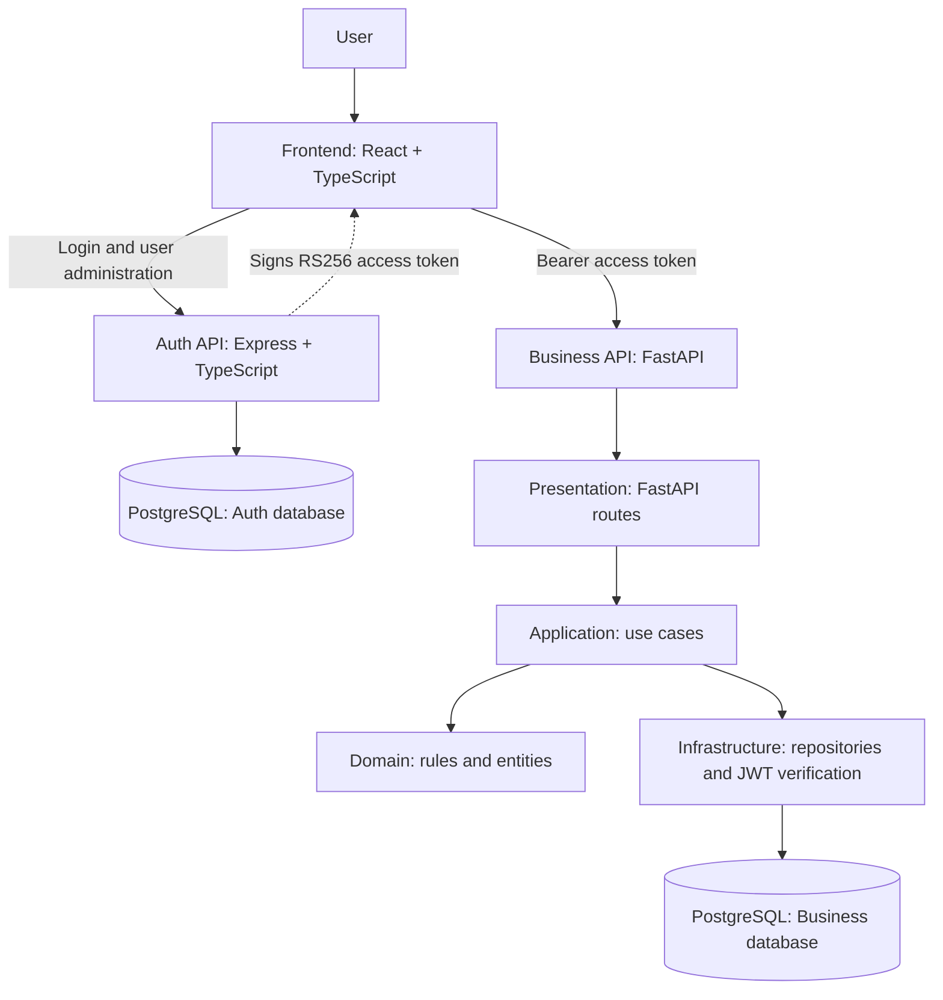

# System Architecture

## 1. Purpose and scope

This document records the approved architecture for the Engine Repair Assessment. It defines service boundaries, security, persistence ownership, and implementation conventions. This is documentation only: application projects and application code are not created by this change.

## 2. Approved technology stack

| Component | Technology | Responsibility |
|---|---|---|
| Frontend | React + TypeScript | User interface and API consumption |
| Authentication API | Node.js + Express + TypeScript | Users, password hashes, roles, login, and JWT issuance |
| Business API | Python + FastAPI | Clients, engines, repair orders, status transitions, and history |
| Persistence models | SQLModel | Typed business-service persistence models |
| Database | PostgreSQL | Separate authentication and business databases |
| Migrations | Alembic | Version and apply database schema changes |
| Python environment/dependencies | UV | Manage Python environment, dependencies, lockfile, and commands |
| Local orchestration | Docker Compose | Run services and PostgreSQL locally |
| CI | GitHub Actions | Automated checks and tests |

## 3. Logical architecture



This is a logical view. In Clean Architecture, dependencies point inward: infrastructure and presentation may depend on application/domain abstractions, but domain rules must not depend on FastAPI, SQLModel, Alembic, or PostgreSQL.

## 4. Service boundaries and data ownership

### 4.1 Authentication service — Express

Owns:
- Admin-controlled user creation and administration; public self-registration is not part of the initial scope.
- Password hashing and credential verification.
- User roles and active/inactive status.
- Login and issuance of signed access tokens.
- Authentication database schema and credentials.

The service stores only password hashes, never plaintext passwords. Use Argon2id or another approved modern password-hashing algorithm. The service does not expose its internal user table to FastAPI.

### 4.2 Business service — FastAPI

Owns:
- Clients and identification/contact data.
- Engines and client ownership.
- Repair orders, lifecycle rules, and status history.
- Business validation and protected business endpoints.
- Business database schema, migrations, and credentials.
- JWT verification and authorization enforcement for business operations.

FastAPI must not implement password login or query the authentication database. It validates the signed token and then applies endpoint-level authorization.

### 4.3 Frontend — React

Owns screens, forms, navigation, loading/error states, and calls to both APIs. It sends access tokens on protected business requests. Role-based navigation is only a usability feature; backend endpoints must independently enforce authorization.

## 5. Databases and persistence

Use one PostgreSQL server for local development, with two separate databases:
- **Authentication database**, owned exclusively by Express.
- **Business database**, owned exclusively by FastAPI.

Each service uses separate database credentials restricted to its own database. Do not query across databases or create cross-database foreign keys. Business tables do not reference the authentication `users` table.

For the FastAPI service:
- SQLModel persistence models live in the infrastructure layer.
- Alembic migration files are versioned and reviewed.
- Alembic must import/register all persistence models for autogeneration.
- Alembic migrations, not `SQLModel.metadata.create_all()`, are the normal schema setup mechanism.
- Use transactions when a business operation must update multiple related rows, such as current repair status and its history entry.
- UV manages Python dependencies, the virtual environment, lockfile, and development commands.

## 6. Clean Architecture in FastAPI

Suggested package layout (a design reference only):

```text
business-service/
├── pyproject.toml
├── uv.lock
├── alembic.ini
├── alembic/
│   ├── env.py
│   └── versions/
├── src/business_service/
│   ├── main.py
│   ├── domain/
│   │   ├── entities/
│   │   ├── value_objects/
│   │   ├── repositories/
│   │   └── exceptions/
│   ├── application/
│   │   ├── dto/
│   │   ├── use_cases/
│   │   └── services/
│   ├── infrastructure/
│   │   ├── database/
│   │   │   ├── models/
│   │   │   ├── session.py
│   │   │   └── repositories/
│   │   ├── security/
│   │   └── config/
│   └── presentation/
│       └── api/
│           ├── dependencies/
│           ├── routes/
│           └── schemas/
└── tests/
    ├── unit/
    ├── integration/
    └── api/
```

- **Domain:** business entities, value objects, repository abstractions, domain rules, and domain exceptions. No framework or persistence dependencies.
- **Application:** use cases, DTOs, and orchestration.
- **Infrastructure:** SQLModel models, repository implementations, database sessions, JWT verification implementation, and configuration.
- **Presentation:** FastAPI routes, request/response schemas, dependency wiring, and HTTP error mapping.

Keep domain entities conceptually separate from SQLModel persistence models where needed to preserve dependency direction. Mapping belongs outside the domain layer.

## 7. Authentication and JWT contract

The approved token approach is **RS256**:
- Express holds the private signing key and issues tokens.
- FastAPI receives the corresponding public verification key only.
- FastAPI explicitly allows RS256 and validates the signature and required claims; decoding alone is not authentication.
- The token is signed, not encrypted. Do not place secrets or sensitive personal data in claims.
- Use `kid` to identify the verification key. Key rotation must retain old public keys until tokens signed by the old key have expired.
- Private keys and other secrets are supplied through environment-specific secret management and are never committed to Git.

Token claims:
- `iss`: `engine-repair-auth`
- `aud`: `engine-repair-api`
- `sub`: user UUID
- `role`: `ADMIN` or `OPERATOR`
- `iat`: issued-at time
- `exp`: expiration time; initial access-token lifetime is 15 minutes
- `jti`: unique token identifier
- JWT header `kid`: key identifier

FastAPI validates the algorithm, signature, issuer, audience, expiration, subject UUID, and allowed role. Invalid, missing, or expired authentication returns HTTP 401. An authenticated user lacking permission receives HTTP 403. Each endpoint's role policy is documented in `docs/api-contract.md`.

Initial role policy:
- `ADMIN`: user administration and all business operations.
- `OPERATOR`: routine client, engine, and repair-order operations; cannot administer users.
- Public self-registration is disabled in the initial scope. Only an authenticated `ADMIN` may create users, and the server validates the assigned role. The first administrator is provisioned through a controlled bootstrap procedure; no public endpoint may create an administrator.

Refresh tokens are out of the initial scope; when an access token expires, the user signs in again.

## 8. API conventions

- Prefix endpoints with `/api/v1`.
- Express owns `/api/v1/auth/*` and `/api/v1/users/*`; FastAPI owns business endpoints. User creation is admin-only (`POST /api/v1/users`); there is no public `POST /api/v1/auth/register` in the initial scope.
- Use JSON request and response bodies, consistent validation, and explicit status codes.
- Use `application/problem+json` for API errors, following RFC 9457 conventions.
- Keep API schemas separate from domain entities and persistence models.
- Do not return password hashes, signing keys, database credentials, or internal exception traces.
- See [API contract](api-contract.md) for endpoints, authorization, JWT requirements, and representative payloads.

## 9. Initial implementation sequence

1. Confirm and document the domain model, approval rules, and service contracts.
2. Initialize the application projects in a separate, explicitly approved step.
3. Configure PostgreSQL ownership, settings, and migrations.
4. Implement authentication, JWT issuance, and tests.
5. Implement business use cases, repositories, JWT verification, and tests.
6. Integrate the frontend.
7. Add Docker Compose, GitHub Actions, and end-to-end checks.
8. Complete the runbook and technical documentation.

## 10. Security and integrity principles

- Never commit credentials, access tokens, private keys, or real environment files.
- Keep `.env.example` limited to placeholders.
- Enforce authorization in backend endpoints; never rely only on frontend controls.
- Enforce uniqueness and referential integrity in the database as well as validating requests.
- Keep authentication and business persistence isolated.
- Use reviewed migrations and test them against a clean database.
- Preserve repair-order history; prefer logical deactivation of referenced clients and engines over physical deletion.
