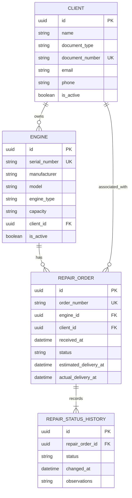

# Business Data Model

## 1. Scope and service ownership

The relational model is split by service ownership:

- **Authentication database (Express):** `users`.
- **Business database (FastAPI):** `clients`, `engines`, `repair_orders`, and `repair_status_history`.

There are no cross-database foreign keys. The business service must not query the authentication database. UUIDs are used as primary identifiers, and timestamps are timezone-aware PostgreSQL `TIMESTAMPTZ` values stored consistently in UTC.

Types below are logical PostgreSQL recommendations. Concrete SQLModel declarations and Alembic migrations are implementation work and are not part of this documentation change.

## 2. Entities and fields

### 2.1 `users` — authentication database

| Field | Suggested type | Nullability / constraint | Purpose |
|---|---|---|---|
| `id` | UUID | PK, required | User identifier |
| `name` | VARCHAR(120) | Required | Display name |
| `email` | VARCHAR(254) | Required, unique | Login identifier; normalize consistently before saving |
| `password_hash` | VARCHAR(255) | Required | Secure password hash only |
| `role` | VARCHAR(20) | Required; `ADMIN` or `OPERATOR` | Authorization role |
| `is_active` | BOOLEAN | Required, default true | Account activation |
| `created_at` | TIMESTAMPTZ | Required | Creation timestamp |
| `updated_at` | TIMESTAMPTZ | Required | Last update timestamp |

Normalize email consistently (for example, trim whitespace and lowercase) and enforce uniqueness in the database. Never store plaintext passwords; use Argon2id or another approved modern password-hashing algorithm. Public self-registration is disabled in the initial scope. Only an authenticated `ADMIN` may create users; the server validates allowed roles, and the first administrator is provisioned through a controlled bootstrap procedure.

### 2.2 `clients` — business database

| Field | Suggested type | Nullability / constraint | Purpose |
|---|---|---|---|
| `id` | UUID | PK, required | Client identifier |
| `name` | VARCHAR(150) | Required | Full name or business name |
| `document_type` | VARCHAR(20) | Required | Identification type |
| `document_number` | VARCHAR(40) | Required | Identification number |
| `email` | VARCHAR(254) | Optional | Contact email |
| `phone` | VARCHAR(30) | Optional | Contact phone |
| `is_active` | BOOLEAN | Required, default true | Logical activation |
| `created_at` | TIMESTAMPTZ | Required | Creation timestamp |
| `updated_at` | TIMESTAMPTZ | Required | Last update timestamp |

Integrity rule: the pair `(document_type, document_number)` is unique. Normalize these fields consistently if business rules require ignoring whitespace/case differences.

### 2.3 `engines` — business database

| Field | Suggested type | Nullability / constraint | Purpose |
|---|---|---|---|
| `id` | UUID | PK, required | Engine identifier |
| `serial_number` | VARCHAR(100) | Required, unique | Manufacturer/serial identification |
| `manufacturer` | VARCHAR(100) | Required | Manufacturer |
| `model` | VARCHAR(100) | Required | Model |
| `engine_type` | VARCHAR(60) | Required | Engine type |
| `capacity` | VARCHAR(60) | Optional | Capacity/specification; units may be included in the description |
| `client_id` | UUID | Required FK to `clients.id` | Current owner/client |
| `registered_at` | TIMESTAMPTZ | Required | Registration timestamp |
| `is_active` | BOOLEAN | Required, default true | Logical activation |
| `created_at` | TIMESTAMPTZ | Required | Creation timestamp |
| `updated_at` | TIMESTAMPTZ | Required | Last update timestamp |

Integrity rules: serial number is unique and `client_id` references an existing client. Add a unique constraint on `(id, client_id)` to support the composite reference from repair orders. Prefer logical deactivation over physical deletion when an engine is referenced by orders.

### 2.4 `repair_orders` — business database

| Field | Suggested type | Nullability / constraint | Purpose |
|---|---|---|---|
| `id` | UUID | PK, required | Internal order identifier |
| `order_number` | VARCHAR(30) | Required, unique | Human-readable reference, e.g. `REP-2026-000001` |
| `engine_id` | UUID | Required | Engine being repaired |
| `client_id` | UUID | Required | Client associated with the order |
| `received_at` | TIMESTAMPTZ | Required | Date/time received |
| `reported_problem` | TEXT | Required | Problem reported by client |
| `technical_diagnosis` | TEXT | Optional | Diagnosis |
| `repair_description` | TEXT | Optional | Work planned/performed |
| `technician_name` | VARCHAR(120) | Optional | Technician name for initial scope |
| `estimated_delivery_at` | TIMESTAMPTZ | Optional | Estimated delivery |
| `actual_delivery_at` | TIMESTAMPTZ | Optional | Actual delivery, when delivered |
| `status` | VARCHAR(30) | Required; controlled values | Current lifecycle status |
| `approval_status` | VARCHAR(20) | Required; default `NOT_REQUIRED`; controlled values | Current client-approval decision |
| `approved_at` | TIMESTAMPTZ | Optional | Timestamp when approval was recorded |
| `approval_notes` | TEXT | Optional | Notes about the approval request or decision |
| `observations` | TEXT | Optional | Additional notes |
| `created_at` | TIMESTAMPTZ | Required | Creation timestamp |
| `updated_at` | TIMESTAMPTZ | Required | Last update timestamp |

Keep both `engine_id` and `client_id` because the order explicitly represents the client and engine. The database must prevent an order from referencing a client different from the engine's current owner. Recommended relational enforcement:
1. Add a unique constraint on `engines(id, client_id)`.
2. Add a composite foreign key from `repair_orders(engine_id, client_id)` to `engines(id, client_id)`.

This means changing an engine's owner requires considering existing orders. The policy for ownership changes must preserve historical order correctness; do not silently rewrite old orders. If the assessment later requires ownership transfers, revisit whether orders should capture the owner at order creation and how to represent that invariant.

The human-readable `order_number` must be generated safely under concurrent requests. UUID remains the primary key; the readable number is a unique business reference.

### 2.5 `repair_status_history` — business database

| Field | Suggested type | Nullability / constraint | Purpose |
|---|---|---|---|
| `id` | UUID | PK, required | History entry identifier |
| `repair_order_id` | UUID | Required FK to `repair_orders.id` | Related order |
| `status` | VARCHAR(30) | Required; controlled values | Status reached |
| `changed_at` | TIMESTAMPTZ | Required | Transition timestamp |
| `observations` | TEXT | Optional | Reason or transition note |

History is append-only from the application's perspective. On order creation, insert the initial history row. On each status transition, update `repair_orders.status` and insert a history record in the same transaction. Never update the current status without recording the transition.

## 3. Relationships

The `users` entity is omitted because it belongs to the separate authentication database.

## 4. Repair statuses and transition rules

Initial controlled statuses:

| Identifier | Meaning |
|---|---|
| `RECEIVED` | Received |
| `IN_DIAGNOSIS` | In diagnosis |
| `AWAITING_APPROVAL` | Awaiting client approval |
| `IN_REPAIR` | In repair |
| `IN_TESTING` | In testing |
| `COMPLETED` | Completed |
| `DELIVERED` | Delivered |

Initial proposed transitions:
- `RECEIVED → IN_DIAGNOSIS`
- `IN_DIAGNOSIS → AWAITING_APPROVAL`
- `AWAITING_APPROVAL → IN_REPAIR` only after approval has been recorded.
- `IN_REPAIR → IN_TESTING`
- `IN_TESTING → COMPLETED`
- `IN_TESTING → IN_REPAIR` if testing fails.
- `COMPLETED → DELIVERED`

The application use case must reject arbitrary transitions. Approval is represented on `repair_orders` for the initial scope:

| `approval_status` | Meaning |
|---|---|
| `NOT_REQUIRED` | This repair does not require client approval. |
| `PENDING` | Approval has been requested and a decision is pending. |
| `APPROVED` | Client approval has been recorded. |
| `REJECTED` | Client declined the proposed repair. |

Rules:
- Orders that require approval must be set to `PENDING` when the approval request is issued; orders that do not require it use `NOT_REQUIRED`.
- A transition from `AWAITING_APPROVAL` to `IN_REPAIR` is permitted only when `approval_status = APPROVED`.
- `approved_at` is populated when approval is recorded and remains null otherwise. When a decision is changed or rejected, the implementation must keep timestamp semantics consistent; do not treat `approved_at` as a general decision timestamp.
- `approval_notes` records relevant context but is not a substitute for a full audit log.
- Record the order's status transitions in `repair_status_history` in the same transaction as the status update.

This model stores the current approval state, not a complete history of approval requests and decisions. If the assessment requires multiple estimates, repeated approval cycles, or an audit trail of every approval decision, introduce a separate `repair_approvals` entity in a later, explicitly scoped change.

## 5. Constraints, indexes, and deletion policy

Recommended constraints:
- Unique normalized user email.
- Unique client `(document_type, document_number)`.
- Unique engine `serial_number`.
- Unique engine `(id, client_id)` to support the composite FK.
- Unique repair `order_number`.
- Foreign keys from engines to clients, repair orders to the matching engine/client pair, and history to repair orders.
- Controlled role, repair status, and approval status values.
- Approval consistency: `approved_at` is populated only when approval has been granted; `IN_REPAIR` cannot be entered from `AWAITING_APPROVAL` unless approval status is `APPROVED`.
- Non-null required fields as shown in the entity tables.

Recommended indexes:
- `clients(document_type, document_number)` (unique constraint/index).
- `engines(serial_number)` (unique constraint/index).
- `engines(client_id)`.
- `repair_orders(order_number)` (unique constraint/index).
- `repair_orders(status)`.
- `repair_orders(engine_id)` and `repair_orders(client_id)` as useful for query patterns and FK operations.
- `repair_status_history(repair_order_id, changed_at)` for chronological order history.

Use logical deactivation for clients and engines that have dependent records. Do not physically delete repair orders or status history during normal operations. Database constraints are the final integrity guard; API validation should produce clear client-facing errors.

## 6. SQLModel and Alembic considerations

- SQLModel persistence models belong in the FastAPI infrastructure layer.
- Domain entities and API schemas should not be coupled to database tables without a deliberate reason.
- Alembic migrations define and version schema changes.
- Alembic's environment must import/register all persistence models so autogeneration can detect their metadata.
- Review autogenerated migrations before applying them.
- Use UUIDs and timezone-aware timestamps consistently.
- Use transactions for operations that update multiple related rows.
- Do not use `SQLModel.metadata.create_all()` as the normal production/local schema migration mechanism; use Alembic.

## 7. Implementation decisions to revisit only if requirements demand them

- The capacity field is initially a descriptive string; switch to numeric capacity plus unit only if the assessment requires calculation/filtering by capacity.
- Technician is initially stored as a name; create a separate technician entity only if technician management is in scope.
- The role set is `ADMIN` and `OPERATOR`; permissions are documented in `docs/api-contract.md`.
- Repair order numbering must be implemented with a concurrency-safe generation strategy.
- The initial approval persistence decision is the four-state `approval_status` plus `approved_at` and `approval_notes` fields on `repair_orders`; use a separate approval entity only if the requirements call for a full decision history.
- Cancellation is not included in the initial status set unless the assessment requirements call for it.
